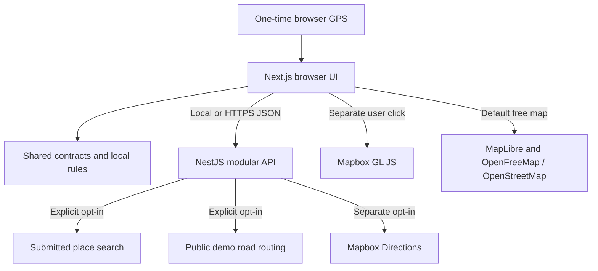

# NaviFree implementation boundaries

## Implemented now

The default is a full-screen, free OpenStreetMap map and a deterministic assistant. The copilot drawer labels its responses as local rules, without claiming an LLM. Actual road routing and search are opt-in prototype integrations. No cloud subscription is needed to develop and test the application. No automatic paid fallback exists.

The API keeps provider-specific response structures away from UI components. Named latitude/longitude objects prevent tuple-order mistakes; the shared adapter converts to GeoJSON order. All route legs are preserved. React renders external strings as text; no external content enters raw HTML.

Mapbox remains an optional integration. At the user's request, MapLibre and OpenFreeMap provide a no-key OpenStreetMap map alongside it. React, Next.js, TypeScript, Tailwind and NestJS remain in place. A Mapbox map token does not automatically enable Directions calls. There is no traffic inference, made-up detour, inferred government speed limit, fabricated business recommendation, or secret browser AI key.

The free map renderer's worker is copied from the installed package into the web app's public assets by predev/prebuild scripts. The generated asset is ignored by Git and regenerated from the lockfile. A small map surface boundary exposes only shared operations; engine-specific setup stays in the map component. Provider changes dispose of the previous instance, and style changes restore route layers. Controls and overlays stay in React; the provider adapters and validation are unchanged.

## Security and operations

- Validate API bodies, query lengths, coordinates, and provider responses at runtime.
- Global and per-connection-IP request limits, bounded search cache, one upstream request at a time per service gate, and upstream timeouts.
- Limits are process-local. Behind a proxy, the connection IP can be shared, intentionally reducing availability rather than trusting spoofable forwarding headers. Configure known trusted proxies deliberately if this becomes limiting.
- Body size limit, security headers, restricted CORS origins, generic upstream errors, and no request-body or provider-URL logging.
- No external analytics, location history, or cloud logging by default. The free basemap makes tile/style/font requests; demo route creation and the local assistant make no provider calls.
- CORS is not authorization. Public API abuse remains possible. Default-disabled billable providers and provider-side quotas are essential; this is not a durable billing guard.
- Web security headers include framing, MIME, referrer, and device-access restrictions. A production CSP still requires deployment-specific Mapbox, API, nonce and worker configuration; the current headers are not presented as a complete CSP.
- Git ignores secrets and build artifacts; Actions has read-only permissions, pinned actions, a frozen lockfile, tests and production dependency audit. Do not send deployment credentials to untrusted pull requests.

## Intentionally deferred

| Feature | Trigger to implement |
| --- | --- |
| PostgreSQL | Cross-device saved routes, favorites, durable preferences or application-owned analytics |
| Authentication | Account-linked features or private dashboards |
| Repository abstraction | The first feature requiring persistence |
| Redis | Shared counters/cache after multiple API instances become necessary |
| LLM | Verified candidates and a provider with acceptable privacy and enforceable spending controls |
| Nearby POIs | Verified Malaysian coverage, bounded query design, provider terms and an actual MVP need |
| Continuous guidance | Tested GPS-to-route progress, off-route detection, arrival logic and device limitations |
| React Native | A working web MVP and a concrete requirement for native location/background behavior |
| Multi-language | Translate UI dictionaries and provider instructions together; currently English only |
| Custom analytics dashboard | Questions that hosted or local aggregate tooling cannot answer |

When PostgreSQL is justified, feature services should depend on small, feature-specific repositories. Keep ORM models internal and API contracts stable. Bind stored records to the verified identity provider subject; never trust client-supplied ownership. Add migrations and tested backups. Do not retain third-party results without storage rights. No PostGIS or generic repository framework is necessary before spatial queries on owned data exist.

React Native can reuse `packages/core` and `packages/api-client`. Map rendering, permissions, device storage, speech and background location remain platform-specific. Do not reuse React DOM components as native screens.

## Milestones

1. Validate this local preview and optional public provider behavior at personal-project scale.
2. Validate a small set of Malaysian address and POI use cases before broad search promises.
3. Add deterministic ranking only over verified POIs; do not invent opening hours or accessibility.
4. Add foreground guidance only with route-progress, GPS-accuracy and rerouting tests.
5. Add identity and PostgreSQL only when users need synced data.

Free public infrastructure cannot guarantee unlimited growth. Scale by replacing provider adapters or using appropriate paid plans when justified, not by bypassing quotas or multiplying free accounts.
